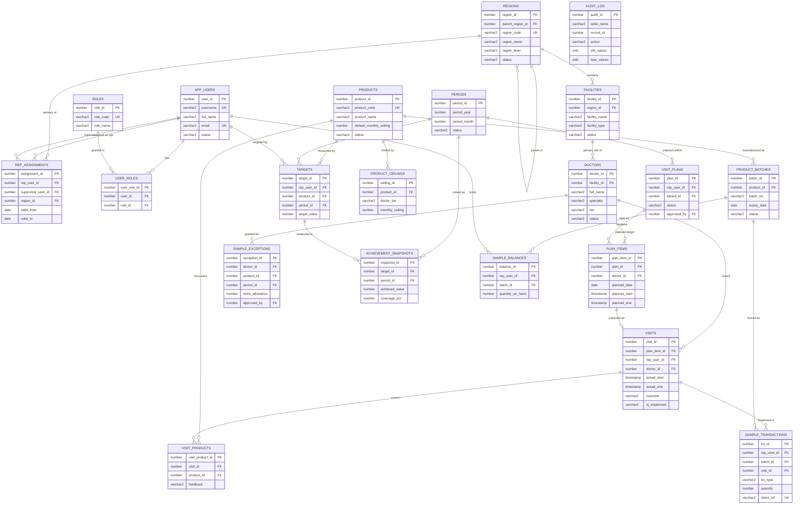

# Pharma Visit System — Data Model & ERD

**Version:** 1.0 · Oracle Database 19c+ · schema owner: `PVS`

---

## 1. Design conventions

| Convention | Decision |
|---|---|
| Primary keys | `GENERATED BY DEFAULT ON NULL AS IDENTITY`, named `<TABLE>_ID` |
| Naming | Tables plural, constraints `<TBL>_<TYPE>_<COL>` (`PK`, `FK`, `UK`, `CK`), indexes `<TBL>_IX<n>` |
| Audit columns | Every table carries `CREATED_BY`, `CREATED_ON`, `UPDATED_BY`, `UPDATED_ON` |
| Soft delete | Reference data uses `STATUS` (`ACTIVE` / `INACTIVE`); rows in use are never deleted |
| Booleans | `VARCHAR2(1)` with `CHECK (col IN ('Y','N'))` — no `NUMBER(1)` flags |
| Time | `TIMESTAMP WITH LOCAL TIME ZONE` for events, `DATE` for business days |
| Money / quantities | `NUMBER(12,2)` and `NUMBER(10)` respectively — never `FLOAT` |
| Text | `VARCHAR2` sized to business meaning; `CLOB` only for notes |

## 2. Key modelling decisions

1. **Balances are stored, not derived at read time.** `SAMPLE_TRANSACTIONS` is the ledger of record; `SAMPLE_BALANCES` is a maintained aggregate updated inside the same transaction as the movement. A nightly reconciliation job compares the two and raises a discrepancy record. Deriving the balance with `SUM()` at every dispense does not survive a real dataset.

2. **Assignments are temporal.** `REP_ASSIGNMENTS` carries `VALID_FROM` / `VALID_TO`, so historical visits stay attributed to the reporting line that existed at the time. Overlap is prevented in `PKG_SECURITY`, not by a constraint, because Oracle has no native range-exclusion constraint.

3. **Visit overlap is a concurrency problem.** No constraint can express "no overlapping time ranges for the same rep". It is enforced in `PKG_VISIT` after locking the representative row (`SELECT ... FOR UPDATE`), which serialises concurrent inserts for that rep only.

4. **Periods gate all writes.** `PERIODS` holds one row per month with `OPEN` / `CLOSED`. Every write API checks it, so closing a month freezes history without triggers on every table.

5. **Ceiling configuration is layered.** `PRODUCTS.DEFAULT_MONTHLY_CEILING` is the fallback; `PRODUCT_CEILINGS` overrides it per physician tier; `SAMPLE_EXCEPTIONS` overrides both for one physician, one product, one month, with an approver.

6. **Audit is generic.** One `AUDIT_LOG` table stores old and new row images as `JSON`, written by a uniform trigger body. Adding a table to the audit scope is a five-line trigger, not a new table.

---

## 3. Entity relationship diagram

---

## 4. Index strategy

| Index | Columns | Rationale |
|---|---|---|
| `VISITS_IX1` | `REP_USER_ID, ACTUAL_START` | Overlap check and rep timeline — the hottest query in the system |
| `VISITS_IX2` | `DOCTOR_ID, ACTUAL_START` | Physician profile and history |
| `VISITS_IX3` | `PLAN_ITEM_ID` | Plan-to-execution join for coverage |
| `SAMPLE_TRX_IX1` | `REP_USER_ID, BATCH_ID, TRX_DATE` | Ledger reconciliation |
| `SAMPLE_TRX_IX2` | `VISIT_ID` | Visit detail drill-down |
| `SAMPLE_TRX_UK1` | `CLIENT_REF` (unique) | Idempotent offline sync — the constraint *is* the deduplication |
| `SAMPLE_BAL_UK1` | `REP_USER_ID, BATCH_ID` (unique) | One balance row per holder and batch |
| `PLAN_ITEMS_IX1` | `PLAN_ID, PLANNED_DATE` | Plan rendering |
| `REP_ASG_IX1` | `REP_USER_ID, VALID_FROM` | Scoping lookups on every request |
| `AUDIT_IX1` | `TABLE_NAME, RECORD_ID` | Record history retrieval |

Foreign key columns are indexed throughout — unindexed FKs cause table-level locks on parent DML, a defect that only appears under concurrency.

---

## 5. What is deliberately *not* modelled

- **No `IS_DELETED` flags on transactional tables.** Visits and movements are corrected by reversing entries, never by deletion — this is what makes the ledger trustworthy.
- **No stored `age`, `month_name`, or other derivable columns.** Derived values live in views.
- **No generic key-value "attributes" table.** It defeats constraints, typing and the optimiser.
- **No `NUMBER(1)` status codes.** Readable domain values with check constraints survive maintenance.
